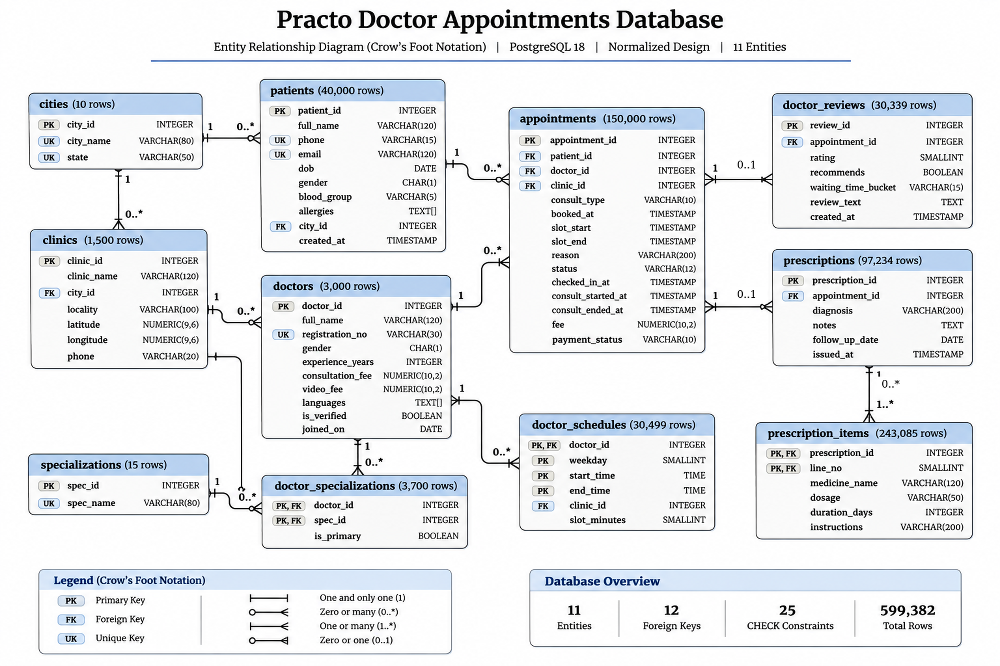
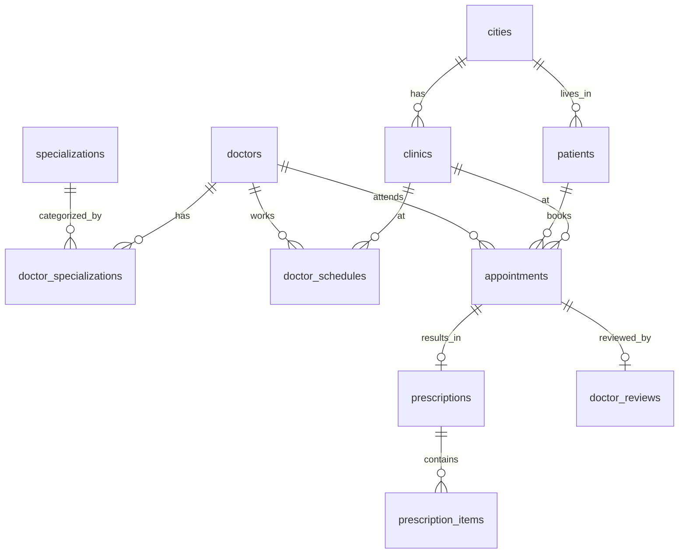

# Schema Design — Practo Doctor Appointments Database

**Team:** T0095 Dwelling · **Section:** C · **Mentor:** Satyaki
**Members:** Animesh Priyanshu, Atul Panda, Ishan Chetwani, Rishabh Singh

---

## 1. Overview

The Practo database is implemented in PostgreSQL under the schema `practo`. It consists of **11 tables** modelling the core entities of a doctor appointment platform: cities, specializations, doctors, doctor_specializations, clinics, doctor_schedules, patients, appointments, prescriptions, prescription_items, and doctor_reviews.

The schema is derived entirely from the 11 CSV seed-data files provided. Table names and column names match the CSV file names and headers exactly, as required by the 30 workload queries. The design preserves referential integrity through foreign keys, enforces business rules through 25 CHECK constraints, and is normalized to **3NF/BCNF** (with workload-specific array qualifications for `languages` and `allergies`).

All tables are created inside `CREATE SCHEMA practo;` with `SET search_path TO practo;`.

---

## 2. Entity-Relationship Overview

The complete visual ER diagram is available at [`diagrams/er_diagram.png`](../diagrams/er_diagram.png).

---

## 3. Table-by-Table Data Dictionary

### 3.1 cities

Reference table of Indian cities where Practo operates.

| Column | Type | Constraints | Description |
|--------|------|-------------|-------------|
| `city_id` | INTEGER | **PK** | Unique city identifier |
| `city_name` | VARCHAR(60) | NOT NULL | City name |
| `state` | VARCHAR(60) | NOT NULL | State the city belongs to |

**Keys:**
- PK: `city_id`
- UNIQUE: `(city_name, state)` — a city name is unique within a state

**Relationships:** Referenced by `clinics.city_id` and `patients.city_id` (1:N).

**Row count:** 10

---

### 3.2 specializations

Medical specializations offered on the platform.

| Column | Type | Constraints | Description |
|--------|------|-------------|-------------|
| `spec_id` | INTEGER | **PK** | Unique specialization identifier |
| `spec_name` | VARCHAR(60) | NOT NULL, UNIQUE | Name of the specialization |

**Keys:**
- PK: `spec_id`
- Candidate key: `spec_name` (UNIQUE)

**Relationships:** Referenced by `doctor_specializations.spec_id` (1:N).

**Row count:** 15

---

### 3.3 doctors

Doctors registered on the Practo platform.

| Column | Type | Constraints | Description |
|--------|------|-------------|-------------|
| `doctor_id` | INTEGER | **PK** | Unique doctor identifier |
| `full_name` | VARCHAR(120) | NOT NULL | Doctor's full name |
| `registration_no` | VARCHAR(30) | NOT NULL, UNIQUE | Medical council registration number |
| `gender` | CHAR(1) | NOT NULL, CHECK | M, F, or X |
| `experience_years` | INTEGER | NOT NULL, CHECK ≥ 0 | Years of experience |
| `consultation_fee` | NUMERIC(10,2) | NOT NULL, CHECK > 0 | In-clinic consultation fee (₹) |
| `video_fee` | NUMERIC(10,2) | CHECK > 0 or NULL | Video consultation fee; NULL if not offered |
| `languages` | TEXT[] | NOT NULL | Array of languages spoken |
| `is_verified` | BOOLEAN | NOT NULL, DEFAULT FALSE | Whether the doctor is platform-verified |
| `joined_on` | DATE | NOT NULL | Date the doctor joined Practo |

**Keys:**
- PK: `doctor_id`
- Candidate key: `registration_no` (UNIQUE) — registration numbers are unique within this database

**CHECK constraints:**
- `chk_doctors_gender`: `gender IN ('M', 'F', 'X')`
- `chk_doctors_experience`: `experience_years >= 0`
- `chk_doctors_consult_fee`: `consultation_fee > 0`
- `chk_doctors_video_fee`: `video_fee IS NULL OR video_fee > 0`
- `chk_doctors_reg_no_format`: `registration_no ~ '^[A-Z]{2,4}MC-\d{6}$'` — validates format like `DLMC-010007`

**Design decisions:**
- `languages` is stored as a PostgreSQL `TEXT[]` array. The queries use `ANY(d.languages)` which requires array type. Normalizing languages into a separate table would break the 30 given queries.
- `video_fee` is nullable because not all doctors offer video consultations (~23% have no video fee).

**Relationships:** Referenced by `appointments`, `doctor_specializations`, `doctor_schedules`.

**Row count:** 3,000

---

### 3.4 doctor_specializations

Junction table implementing the M:N relationship between doctors and specializations.

| Column | Type | Constraints | Description |
|--------|------|-------------|-------------|
| `doctor_id` | INTEGER | **PK**, FK → doctors | Doctor identifier |
| `spec_id` | INTEGER | **PK**, FK → specializations | Specialization identifier |
| `is_primary` | BOOLEAN | NOT NULL, DEFAULT FALSE | Whether this is the doctor's primary specialization |

**Keys:**
- PK: `(doctor_id, spec_id)` — composite
- Partial unique index: `(doctor_id) WHERE is_primary` — at most one primary specialization per doctor is enforced through a partial unique index on `doctor_id WHERE is_primary`. The database index does not enforce the existence of a primary specialization. However, the supplied seed dataset was validated, and all 3,000 doctors have exactly one primary specialization.

**FK actions:**
- `doctor_id → doctors`: ON DELETE CASCADE (removing a doctor removes their specializations)
- `spec_id → specializations`: ON DELETE RESTRICT (cannot delete a specialization in use)

**Relationships:** M:N bridge between `doctors` and `specializations`.

**Row count:** 3,700 (3,000 doctors × ~1.23 specializations on average; 700 doctors have a secondary specialization)

---

### 3.5 clinics

Physical clinic locations where doctors consult.

| Column | Type | Constraints | Description |
|--------|------|-------------|-------------|
| `clinic_id` | INTEGER | **PK** | Unique clinic identifier |
| `clinic_name` | VARCHAR(120) | NOT NULL | Clinic name |
| `city_id` | INTEGER | NOT NULL, FK → cities | City where the clinic is located |
| `locality` | VARCHAR(100) | NOT NULL | Neighbourhood/locality name |
| `latitude` | NUMERIC(9,6) | NOT NULL, CHECK [-90,90] | Geographic latitude |
| `longitude` | NUMERIC(9,6) | NOT NULL, CHECK [-180,180] | Geographic longitude |
| `phone` | VARCHAR(20) | NOT NULL | Clinic phone number |

**Keys:**
- PK: `clinic_id`

**CHECK constraints:**
- `chk_clinics_latitude`: `latitude BETWEEN -90 AND 90`
- `chk_clinics_longitude`: `longitude BETWEEN -180 AND 180`

**FK actions:**
- `city_id → cities`: ON DELETE RESTRICT (cannot delete a city with clinics)

**Relationships:** Referenced by `doctor_schedules.clinic_id` and `appointments.clinic_id` (1:N).

**Row count:** 1,500

---

### 3.6 doctor_schedules

Weekly recurring schedule blocks for each doctor. Each row represents a time window on a specific weekday at a specific clinic (or video if `clinic_id` is NULL).

| Column | Type | Constraints | Description |
|--------|------|-------------|-------------|
| `doctor_id` | INTEGER | **PK**, FK → doctors | Doctor identifier |
| `weekday` | SMALLINT | **PK**, CHECK 1–7 | ISO weekday (1 = Monday, 7 = Sunday) |
| `start_time` | TIME | **PK**, NOT NULL | Block start time |
| `end_time` | TIME | NOT NULL, CHECK > start_time | Block end time |
| `clinic_id` | INTEGER | FK → clinics, nullable | Clinic for in-person; NULL for video consultation |
| `slot_minutes` | SMALLINT | NOT NULL, CHECK IN (10,15,20) | Duration of each appointment slot |

**Keys:**
- PK: `(doctor_id, weekday, start_time)` — composite; a doctor has at most one schedule block per weekday + start time

**CHECK constraints:**
- `chk_schedules_weekday`: `weekday BETWEEN 1 AND 7`
- `chk_schedules_time_order`: `end_time > start_time`
- `chk_schedules_slot_minutes`: `slot_minutes IN (10, 15, 20)` — only these slot lengths exist in the data

**Design decisions:**
- `clinic_id` is nullable (video slots have no clinic). Therefore it cannot be part of the primary key.
- The PK `(doctor_id, weekday, start_time)` is verified unique across all 30,499 rows.

**FK actions:**
- `doctor_id → doctors`: ON DELETE CASCADE
- `clinic_id → clinics`: ON DELETE RESTRICT

**Relationships:** Links doctors to clinics and time slots. Used by R03 (slot picker) and W01 (booking).

**Row count:** 30,499

---

### 3.7 patients

Registered patients on the platform.

| Column | Type | Constraints | Description |
|--------|------|-------------|-------------|
| `patient_id` | INTEGER | **PK** | Unique patient identifier |
| `full_name` | VARCHAR(120) | NOT NULL | Patient's full name |
| `phone` | VARCHAR(15) | NOT NULL, UNIQUE | Mobile number (primary sign-in method) |
| `email` | VARCHAR(120) | UNIQUE (nullable) | Email address; NULL for ~35% of patients |
| `dob` | DATE | NOT NULL | Date of birth |
| `gender` | CHAR(1) | NOT NULL, CHECK | M, F, or X |
| `blood_group` | VARCHAR(5) | CHECK valid values, nullable | Blood group; NULL for ~8% of patients |
| `allergies` | TEXT[] | nullable | Array of known allergies; NULL when allergy information is not recorded |
| `city_id` | INTEGER | NOT NULL, FK → cities | Patient's city |
| `created_at` | TIMESTAMPTZ | NOT NULL, DEFAULT NOW() | Account creation timestamp |

**Keys:**
- PK: `patient_id`
- Candidate key: `phone` (UNIQUE, NOT NULL)
- Optional UNIQUE attribute: `email` — optional UNIQUE attribute; all non-NULL email values must be unique.

**CHECK constraints:**
- `chk_patients_gender`: `gender IN ('M', 'F', 'X')`
- `chk_patients_blood_group`: valid blood group values or NULL

**Design decisions:**
- `email` is nullable because some patients do not provide an email address (13,940 out of 40,000 patients, ~35%, have no email). The UNIQUE constraint ensures that all non-NULL email values are unique. PostgreSQL permits multiple NULL values under an ordinary UNIQUE constraint.
- `allergies` is stored as `TEXT[]` array. The queries use `@>` (array contains) operator, which requires array type. Normalizing allergies into a separate table would break R10.
- `blood_group` is nullable because ~8% of patients have no recorded blood group.

**FK actions:**
- `city_id → cities`: ON DELETE RESTRICT

**Relationships:** Referenced by `appointments.patient_id` (1:N).

**Row count:** 40,000

---

### 3.8 appointments

Every appointment booked on the platform. The central fact table.

| Column | Type | Constraints | Description |
|--------|------|-------------|-------------|
| `appointment_id` | INTEGER | **PK** | Unique appointment identifier |
| `patient_id` | INTEGER | NOT NULL, FK → patients | Patient who booked |
| `doctor_id` | INTEGER | NOT NULL, FK → doctors | Doctor consulted |
| `clinic_id` | INTEGER | FK → clinics, nullable | Clinic (NULL for VIDEO) |
| `consult_type` | VARCHAR(10) | NOT NULL, CHECK | IN_CLINIC or VIDEO |
| `booked_at` | TIMESTAMPTZ | NOT NULL | When the appointment was booked |
| `slot_start` | TIMESTAMPTZ | NOT NULL | Appointment slot start |
| `slot_end` | TIMESTAMPTZ | NOT NULL, CHECK > slot_start | Appointment slot end |
| `reason` | VARCHAR(200) | NOT NULL | Reason for visit |
| `status` | VARCHAR(12) | NOT NULL, CHECK | BOOKED, CHECKED_IN, COMPLETED, CANCELLED, NO_SHOW |
| `checked_in_at` | TIMESTAMPTZ | nullable | Check-in time (only for IN_CLINIC) |
| `consult_started_at` | TIMESTAMPTZ | nullable | When consultation started |
| `consult_ended_at` | TIMESTAMPTZ | nullable | When consultation ended |
| `fee` | NUMERIC(10,2) | NOT NULL, CHECK > 0 | Appointment fee (₹) |
| `payment_status` | VARCHAR(10) | NOT NULL, CHECK | PENDING, PAID, REFUNDED |

**Keys:**
- PK: `appointment_id`

**CHECK constraints (8):**
- `chk_appt_consult_type`: `consult_type IN ('IN_CLINIC', 'VIDEO')`
- `chk_appt_status`: valid status values
- `chk_appt_payment_status`: `payment_status IN ('PENDING', 'PAID', 'REFUNDED')`
- `chk_appt_slot_order`: `slot_end > slot_start`
- `chk_appt_fee_positive`: `fee > 0`
- `chk_appt_clinic_type`: ensures VIDEO ↔ NULL clinic_id and IN_CLINIC ↔ NOT NULL clinic_id
- `chk_appt_checkin_clinic`: only IN_CLINIC appointments can have `checked_in_at`
- `chk_appt_refund_cancel`: REFUNDED payment status only for CANCELLED appointments

**Design decisions:**
- `fee` is a **derived/redundant** column: it could be computed from `doctors.consultation_fee` or `doctors.video_fee` based on `consult_type`. However, keeping it is justified because:
  (a) Fees may change over time; the fee at booking time must be preserved.
  (b) The 30 queries reference `appointments.fee` directly (R16, R21, W01).
- `slot_end` is a **derived/redundant** column: it equals `slot_start + slot_minutes * interval '1 minute'`. Keeping it is justified because:
  (a) The queries reference `slot_end` directly (W04).
  (b) Recalculating it would require joining doctor_schedules for every query.
- `checked_in_at`, `consult_started_at`, `consult_ended_at` are nullable because they are populated progressively as the appointment progresses through its lifecycle.

**Data observation:** 6,021 cancelled appointments have `PAID` payment status (not refunded). This is valid — late cancellations may not receive refunds.

**FK actions:**
- `patient_id → patients`: ON DELETE RESTRICT (cannot delete a patient with appointments)
- `doctor_id → doctors`: ON DELETE RESTRICT (cannot delete a doctor with appointments)
- `clinic_id → clinics`: ON DELETE RESTRICT

**Relationships:**
- References patients (N:1), doctors (N:1), clinics (N:1)
- Referenced by prescriptions (1:1) and doctor_reviews (1:1)

**Row count:** 150,000

---

### 3.9 prescriptions

Prescriptions are intended for completed consultations. The database enforces at most one prescription per appointment, but does not enforce that the appointment is completed.

| Column | Type | Constraints | Description |
|--------|------|-------------|-------------|
| `prescription_id` | INTEGER | **PK** | Unique prescription identifier |
| `appointment_id` | INTEGER | NOT NULL, UNIQUE, FK → appointments | The appointment this prescription belongs to |
| `diagnosis` | VARCHAR(200) | NOT NULL | Diagnosis given |
| `notes` | TEXT | nullable | Optional clinical notes |
| `follow_up_date` | DATE | nullable | Recommended follow-up date; NULL when no follow-up is recommended |
| `issued_at` | TIMESTAMPTZ | NOT NULL | When the prescription was issued |

**Keys:**
- PK: `prescription_id`
- Candidate key: `appointment_id` (UNIQUE) — enforces 1:1 with appointments

**FK actions:**
- `appointment_id → appointments`: ON DELETE CASCADE

**Relationships:**
- 1:1 with appointments (UNIQUE constraint on appointment_id)
- Referenced by prescription_items (1:N)

**Row count:** 97,234

---

### 3.10 prescription_items

Individual medicines on a prescription.

| Column | Type | Constraints | Description |
|--------|------|-------------|-------------|
| `prescription_id` | INTEGER | **PK**, FK → prescriptions | Prescription this item belongs to |
| `line_no` | SMALLINT | **PK**, CHECK ≥ 1 | Line number within the prescription |
| `medicine_name` | VARCHAR(120) | NOT NULL | Name of the medicine |
| `dosage` | VARCHAR(20) | NOT NULL, CHECK format | Dosage in X-Y-Z format (morning-afternoon-night) |
| `duration_days` | INTEGER | NOT NULL, CHECK > 0 | Duration in days |
| `instructions` | VARCHAR(200) | nullable | Optional instructions (e.g., "After food") |

**Keys:**
- PK: `(prescription_id, line_no)` — composite

**CHECK constraints:**
- `chk_pi_line_no_positive`: `line_no >= 1`
- `chk_pi_duration_positive`: `duration_days > 0`
- `chk_pi_dosage_format`: `dosage ~ '^\d+-\d+-\d+$'` — validates the morning-afternoon-night pattern

**FK actions:**
- `prescription_id → prescriptions`: ON DELETE CASCADE

**Relationships:** N:1 with prescriptions.

**Row count:** 243,085

---

### 3.11 doctor_reviews

Patient reviews are intended for completed consultations. At most one review is permitted per appointment; completion status is not database-enforced.

| Column | Type | Constraints | Description |
|--------|------|-------------|-------------|
| `review_id` | INTEGER | **PK** | Unique review identifier |
| `appointment_id` | INTEGER | NOT NULL, UNIQUE, FK → appointments | The reviewed appointment |
| `rating` | SMALLINT | NOT NULL, CHECK 1–5 | Rating (1 = worst, 5 = best) |
| `recommends` | BOOLEAN | NOT NULL | Whether the patient recommends the doctor |
| `wait_time_bucket` | VARCHAR(15) | CHECK valid values, nullable | Categorized wait time |
| `review_text` | TEXT | nullable | Optional free-text review |
| `created_at` | TIMESTAMPTZ | NOT NULL | When the review was submitted |

**Keys:**
- PK: `review_id`
- Candidate key: `appointment_id` (UNIQUE) — enforces 1:1 with appointments

**CHECK constraints:**
- `chk_reviews_rating`: `rating BETWEEN 1 AND 5`
- `chk_reviews_wait_bucket`: valid bucket values (`<15 min`, `15-30 min`, `30-60 min`, `>1 hr`) or NULL

**Design decision:** `wait_time_bucket` is a **derived/redundant** column — it could be computed from `appointments.consult_started_at - appointments.slot_start`. Keeping it is justified because:
(a) The bucket thresholds are a business decision, not a mathematical function.
(b) The patient self-reports the wait experience, which may differ from system timestamps.

**FK actions:**
- `appointment_id → appointments`: ON DELETE CASCADE

**Relationships:** 1:1 with appointments.

**Row count:** 30,339

---

## 4. Relationship Summary

| Relationship | Type | Description |
|---|---|---|
| cities → clinics | 1:N | A city has many clinics |
| cities → patients | 1:N | A city has many patients |
| doctors → doctor_specializations | 1:N | A doctor has one or more specializations |
| specializations → doctor_specializations | 1:N | A specialization is held by many doctors |
| doctors ↔ specializations | M:N | Resolved via `doctor_specializations` junction table |
| doctors → doctor_schedules | 1:N | A doctor has many schedule blocks |
| clinics → doctor_schedules | 1:N | A clinic hosts many schedule blocks |
| patients → appointments | 1:N | A patient books many appointments |
| doctors → appointments | 1:N | A doctor has many appointments |
| clinics → appointments | 1:N | A clinic hosts many appointments |
| appointments → prescriptions | 1:1 | A completed appointment has at most one prescription |
| prescriptions → prescription_items | 1:N | A prescription has zero or more medicine items |
| appointments → doctor_reviews | 1:1 | An appointment has at most one review |

---

## 5. Functional Dependencies and Normal-Form Analysis

> **Workload-specific normalization consideration:** The `doctors.languages` and `patients.allergies` columns use PostgreSQL `TEXT[]` arrays to support the supplied workload queries, which rely on array operators such as `ANY()` and `@>`. Under strict classical relational theory, these multi-valued attributes raise a 1NF atomicity concern. They are intentionally retained as PostgreSQL-specific design choices to preserve workload compatibility. Accordingly, the BCNF discussion for these relations applies to their scalar attributes and functional dependencies, with this array-related qualification.

### 5.1 cities
- FDs: `city_id → city_name, state`
- `(city_name, state) → city_id` (candidate key)
- **BCNF** ✅ — every determinant is a superkey.

### 5.2 specializations
- FDs: `spec_id → spec_name`, `spec_name → spec_id`
- **BCNF** ✅ — both are candidate keys.

### 5.3 doctors
- FDs: `doctor_id → full_name, registration_no, gender, experience_years, consultation_fee, video_fee, languages, is_verified, joined_on`
- `registration_no → doctor_id, full_name, …` (candidate key)
- No partial or transitive dependencies among scalar attributes.
- **BCNF (with array qualification)** ✅ — all non-trivial functional dependencies on scalar attributes have a superkey as their determinant. Under strict classical relational theory, the multi-valued `languages` attribute raises a 1NF atomicity concern; it is intentionally retained as a workload-specific choice.

### 5.4 doctor_specializations
- FDs: `(doctor_id, spec_id) → is_primary`
- Additional constraint: at most one primary specialization per doctor is enforced through the partial unique index (`doctor_id WHERE is_primary`).
- **BCNF** ✅ — the PK `(doctor_id, spec_id)` is the only determinant.

### 5.5 clinics
- FDs: `clinic_id → clinic_name, city_id, locality, latitude, longitude, phone`
- No transitive dependencies (city_id is a FK, not functionally determined by another non-key column).
- **BCNF** ✅

### 5.6 doctor_schedules
- FDs: `(doctor_id, weekday, start_time) → end_time, clinic_id, slot_minutes`
- **BCNF** ✅ — the PK is the only determinant.

### 5.7 patients
- FDs: `patient_id → full_name, phone, email, dob, gender, blood_group, allergies, city_id, created_at`
- `phone → patient_id, …` (candidate key)
- Optional unique attribute: `email` is unique when non-NULL, but not an unconditional candidate key due to nullability.
- No partial or transitive dependencies among scalar attributes.
- **BCNF (with array qualification)** ✅ — all non-trivial functional dependencies on scalar attributes have a superkey as their determinant. Under strict classical relational theory, the multi-valued `allergies` attribute raises a 1NF atomicity concern; it is intentionally retained as a workload-specific choice.

### 5.8 appointments
- FDs: `appointment_id → patient_id, doctor_id, clinic_id, consult_type, booked_at, slot_start, slot_end, reason, status, checked_in_at, consult_started_at, consult_ended_at, fee, payment_status`
- **Redundant columns noted:**
  - `fee`: derivable from `doctors.consultation_fee` or `video_fee` (justified: fee at booking time may differ from current fee)
  - `slot_end`: derivable from `slot_start + slot_minutes` (justified: avoids join with schedules, and slot_end is used in queries W04)
- **3NF/BCNF** ✅ — despite redundancy, the PK determines all attributes and there are no transitive dependencies among stored columns.

### 5.9 prescriptions
- FDs: `prescription_id → appointment_id, diagnosis, notes, follow_up_date, issued_at`
- `appointment_id → prescription_id, …` (candidate key, UNIQUE)
- **BCNF** ✅

### 5.10 prescription_items
- FDs: `(prescription_id, line_no) → medicine_name, dosage, duration_days, instructions`
- **BCNF** ✅

### 5.11 doctor_reviews
- FDs: `review_id → appointment_id, rating, recommends, wait_time_bucket, review_text, created_at`
- `appointment_id → review_id, …` (candidate key, UNIQUE)
- **Redundant column:** `wait_time_bucket` is derivable from appointment timestamps (justified: self-reported patient experience)
- **BCNF** ✅

---

## 6. CHECK Constraints Summary (25 total)

| # | Constraint | Table | Rule |
|---|---|---|---|
| 1 | `chk_doctors_gender` | doctors | `gender IN ('M','F','X')` |
| 2 | `chk_doctors_experience` | doctors | `experience_years >= 0` |
| 3 | `chk_doctors_consult_fee` | doctors | `consultation_fee > 0` |
| 4 | `chk_doctors_video_fee` | doctors | `video_fee IS NULL OR video_fee > 0` |
| 5 | `chk_doctors_reg_no_format` | doctors | Regex: `^[A-Z]{2,4}MC-\d{6}$` |
| 6 | `chk_clinics_latitude` | clinics | `latitude BETWEEN -90 AND 90` |
| 7 | `chk_clinics_longitude` | clinics | `longitude BETWEEN -180 AND 180` |
| 8 | `chk_schedules_weekday` | doctor_schedules | `weekday BETWEEN 1 AND 7` |
| 9 | `chk_schedules_time_order` | doctor_schedules | `end_time > start_time` |
| 10 | `chk_schedules_slot_minutes` | doctor_schedules | `slot_minutes IN (10, 15, 20)` |
| 11 | `chk_patients_gender` | patients | `gender IN ('M','F','X')` |
| 12 | `chk_patients_blood_group` | patients | Valid blood group or NULL |
| 13 | `chk_appt_consult_type` | appointments | `consult_type IN ('IN_CLINIC','VIDEO')` |
| 14 | `chk_appt_status` | appointments | Valid statuses |
| 15 | `chk_appt_payment_status` | appointments | `payment_status IN ('PENDING','PAID','REFUNDED')` |
| 16 | `chk_appt_slot_order` | appointments | `slot_end > slot_start` |
| 17 | `chk_appt_fee_positive` | appointments | `fee > 0` |
| 18 | `chk_appt_clinic_type` | appointments | VIDEO ↔ NULL clinic, IN_CLINIC ↔ NOT NULL clinic |
| 19 | `chk_appt_checkin_clinic` | appointments | `checked_in_at` only for IN_CLINIC |
| 20 | `chk_appt_refund_cancel` | appointments | REFUNDED only for CANCELLED |
| 21 | `chk_pi_line_no_positive` | prescription_items | `line_no >= 1` |
| 22 | `chk_pi_duration_positive` | prescription_items | `duration_days > 0` |
| 23 | `chk_pi_dosage_format` | prescription_items | Regex: `^\d+-\d+-\d+$` |
| 24 | `chk_reviews_rating` | doctor_reviews | `rating BETWEEN 1 AND 5` |
| 25 | `chk_reviews_wait_bucket` | doctor_reviews | Valid bucket values or NULL |

---

## 7. Automatic Indexes (from PK and UNIQUE)

No manual indexes are created in Phase 2. The following indexes exist automatically from PK and UNIQUE constraints:

| Table | Index | Columns | Type |
|---|---|---|---|
| cities | PK | `city_id` | B-tree |
| cities | UNIQUE | `(city_name, state)` | B-tree |
| specializations | PK | `spec_id` | B-tree |
| specializations | UNIQUE | `spec_name` | B-tree |
| doctors | PK | `doctor_id` | B-tree |
| doctors | UNIQUE | `registration_no` | B-tree |
| doctor_specializations | PK | `(doctor_id, spec_id)` | B-tree |
| doctor_specializations | Partial UNIQUE | `doctor_id WHERE is_primary` | B-tree |
| clinics | PK | `clinic_id` | B-tree |
| doctor_schedules | PK | `(doctor_id, weekday, start_time)` | B-tree |
| patients | PK | `patient_id` | B-tree |
| patients | UNIQUE | `phone` | B-tree |
| patients | UNIQUE | `email` | B-tree |
| appointments | PK | `appointment_id` | B-tree |
| prescriptions | PK | `prescription_id` | B-tree |
| prescriptions | UNIQUE | `appointment_id` | B-tree |
| prescription_items | PK | `(prescription_id, line_no)` | B-tree |
| doctor_reviews | PK | `review_id` | B-tree |
| doctor_reviews | UNIQUE | `appointment_id` | B-tree |

---

## 8. Data Loading

Tables are loaded using `\copy` in dependency order (parents before children):

1. `cities` (root)
2. `specializations` (root)
3. `doctors` (no FK dependencies on loaded tables)
4. `doctor_specializations` (depends on doctors, specializations)
5. `clinics` (depends on cities)
6. `doctor_schedules` (depends on doctors, clinics)
7. `patients` (depends on cities)
8. `appointments` (depends on patients, doctors, clinics)
9. `prescriptions` (depends on appointments)
10. `prescription_items` (depends on prescriptions)
11. `doctor_reviews` (depends on appointments)

All 11 CSV files load without errors. Final `ANALYZE` updates statistics for the query planner.

---

## 9. Integrity Check Results

All checks were run after loading the seed data.

| Check | Description | Violations |
|---|---|---|
| Orphan doctor appointments | Appointments referencing non-existent doctors | **0** |
| Orphan patient appointments | Appointments referencing non-existent patients | **0** |
| IN_CLINIC missing clinic | IN_CLINIC appointments without a clinic_id | **0** |
| VIDEO with clinic | VIDEO appointments that have a clinic_id | **0** |
| Orphan prescriptions | Prescriptions referencing non-existent appointments | **0** |
| Orphan reviews | Reviews referencing non-existent appointments | **0** |
| Duplicate primary specs | Doctors with more than one primary specialization | **0** |
| Refunded not cancelled | Refunded payments for non-cancelled appointments | **0** |
| Completed no end time | Completed appointments without `consult_ended_at` | **0** |
| Doctors without spec | Doctors with no specialization record | **0** |

**Data observations (not errors):**
- 6,021 cancelled appointments have `PAID` status (not refunded). This represents legitimate late-cancellation scenarios where refunds are not issued.
- ~35% of patients (13,940) have no email address.
- ~8% of patients (3,204) have no recorded blood group.

---

## 10. Design Decisions and Justifications

1. **Schema namespace:** All tables under `CREATE SCHEMA practo` with `SET search_path TO practo;` as required.

2. **Table and column naming:** Exactly matches the CSV file names and headers to ensure compatibility with the 30 workload queries.

3. **Array columns (`languages`, `allergies`):** Kept as PostgreSQL `TEXT[]` arrays rather than normalized into separate tables because the workload queries use array operators (`ANY()`, `@>`).

4. **Redundant columns preserved with justification:**
   - `appointments.fee`: Preserves the fee at booking time (may differ from the doctor's current fee).
   - `appointments.slot_end`: Avoids expensive joins with `doctor_schedules` for every query needing the end time.
   - `doctor_reviews.wait_time_bucket`: Self-reported patient perception, not a computed metric.

5. **ON DELETE rules:**
   - CASCADE for dependent detail tables (specializations of a doctor, schedule blocks, prescription items).
   - RESTRICT for appointments → patients/doctors (prevent accidental deletion of entities with appointment history).
   - RESTRICT for clinic references in schedules and appointments (prevent deletion of clinics that are referenced).

6. **Nullable columns:** Carefully chosen based on data analysis — only columns that are genuinely absent for a subset of records are nullable (email, video_fee, blood_group, allergies, clinic_id for video, checked_in_at, consult timestamps, notes, follow_up_date, wait_time_bucket, review_text, instructions).
